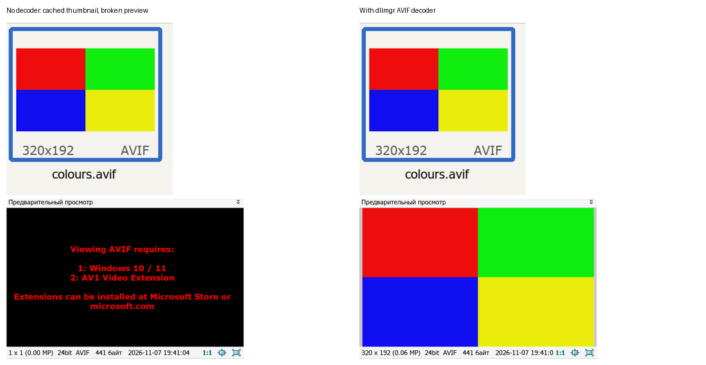

# AVIF in FastStone (WineHQ 60703)

An experimental, reversible workaround for FastStone 8.5 x86 on Wine 11.0.
Wine's WIC has no AVIF decoder. This adds a native x86 COM decoder built from
libavif and libaom, using open-source code and no Microsoft binaries.

From an updated dllmgr installation:

```sh
dllmgr fix faststone-avif
# Undo, after closing FastStone:
dllmgr uninstall faststone-avif
```

From a checkout, the equivalent per-bug entry points are
`scripts/apply-winehq-60703.sh` and `scripts/undo-winehq-60703.sh`.
WINEPREFIX selects an existing prefix (default ~/.wine); both also accept
`--prefix PATH`. Close FastStone and other WIC clients before changing codecs.
Installation downloads a pinned, SHA256-verified x86 package with dependency
licenses. No compilation or administrator privileges are needed on Linux.

**Scope:** all 32-bit WIC applications in that Wine prefix. This is COM codec
registration, not a FastStone-specific DLL override. The installer creates only
two decoder-owned registry trees and its own DLL/notices; undo restores their
original absence. Existing registrations/files are refused. If managed content
was changed externally, undo stops rather than deleting it. System Wine and
the existing five-fix faststone-v2 recipe are independent of this codec.

## What is supported

Still display of AVIF files whose major brand is avif/avis, with SDR sRGB or
unspecified color information, including alpha. A sequence exposes its first
image. This first version rejects ICC/Exif metadata, crop/rotation/mirroring,
non-square pixels, HDR and other unsupported color spaces instead of silently
rendering them incorrectly. Limits: 128 MiB input, 16384 per dimension, 64 Mi
pixels, 1024 parsed images, two decode threads. Full animation and AVIF
conformance are not claimed. Details: [decoder contract](../codecs/avif/README.md).
The codec remains separate from the verified faststone-v2 bundle.

## Evidence, 2026-11-07

- [Native Windows x86 CI](https://github.com/unxed/dllmgr/actions/runs/42402910201),
  source 72310aced08b695d7750dabbba7af49b834a734d: zero test failures. Checks
  exact lossless RGBA pixels, alpha conversion, stride/rect/buffer handling,
  malformed and unsupported files, COM activation, generic WIC discovery and
  restoration of registration absence. Catalog and apply-scripts also passed
  at that SHA. Production binary imports only ole32 and KERNEL32.
- DLL SHA256: c9f603b6b4290d4b917e7e61ee82b4500cbc476c022045df80d6bf0f0e3f19c5.
  libavif v1.4.2 / libaom v3.14.1, exact revisions in the package notices.
- Actual laptop: Wine 11.0, FastStone 8.5 x86 in a win64 prefix, 192 DPI,
  3072x1728. FastStone SHA256:
  05c877e57b25c37e75b8c2a07a5f0ecc31e3b1bb8d12aeb9554c93dcde4ce621.
  Stock WIC returns COMPONENTNOTFOUND. The final CI DLL decodes Bugzilla
  attachment 82617 as **626x417** (BGRA FNV-1a 856c05a6d9825d1c).
  The attachment's photograph is not republished here.
- Actual app, same generated 320x192 four-color AVIF: stock preview shows the
  AV1-extension notice and 1x1 dimensions;
  final DLL displays the image fullscreen, in the thumbnail and in the preview
  panel, with correct dimensions and filename. Native module loading is
  recorded. Enter changes from fullscreen to the browser. Temporary install
  and settings changes were undone after testing. A previously cached thumbnail
  survives codec removal, so it is not evidence of successful decoding. The picture contains
  only cropped synthetic content, without personal paths or desktop content.



## Failed attempts worth retaining

- HKCU Classes registration was not discovered by Wine 11: its HKCR mapping
  uses machine Classes, without the Windows per-user merge. Registration now
  uses HKLM **inside the chosen prefix**, with explicit scope above.
- A QWORD pattern Position worked under Wine but broke native Windows generic
  discovery. Using the documented DWORD made the same test pass on Windows.
- The first dependency check matched the DLL's own dumpbin heading, producing
  a red job after all tests passed. Matching only dependency lines fixed it.
- A temporary WM_KEYDOWN/UP-only observer action failed to change viewer mode;
  the existing foreground-guarded real Enter input succeeded. That failed
  harness action was not retained as an application fix.
- A prior observer used ANSI process creation and mangled non-ASCII paths.
  It now launches with CreateProcessW; tests use explicit Windows paths.
- One disposable headless Wine prefix stalled during registry calls; its own
  wineserver was restarted. No user-prefix server was killed. Default-prefix
  tests use bounded child commands and a finally block to restore settings.
- A follow-up uncached-folder observer attempt lost foreground before Enter
  and stopped with status 7; settings were restored. No foreground check was
  bypassed. The before/after preview comparison uses the completed runs.

Repack the exact downloaded successful CI artifact with
`python3 tools/package-avif.py ARTIFACT OUTPUT.zip`. It verifies the original
artifact checksums and includes all dependency notices in both their original
paths and THIRD-PARTY-NOTICES.txt. Do not substitute a new binary under the
existing pinned release name.
