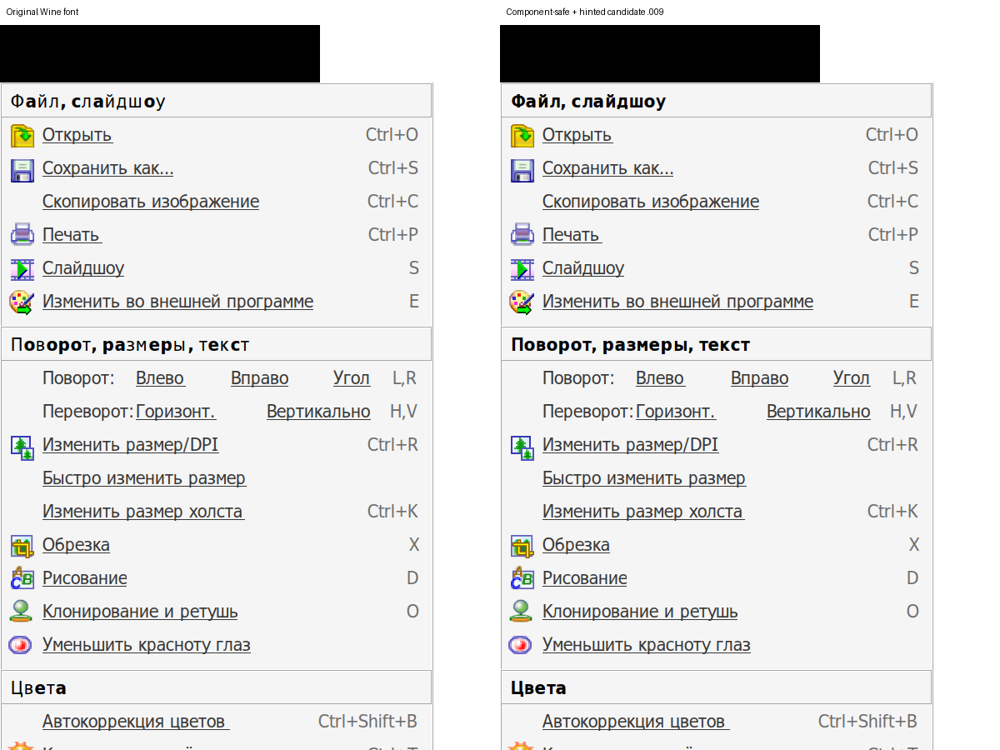

# Corrected Cyrillic Tahoma Bold (WineHQ 26037)

A reversible workaround for the mixed regular/bold Cyrillic in Wine 11.0's
Tahoma Bold. FastStone 8.5's fullscreen panel exposes the defect, but it is in
the font data rather than the program's text. The owner describes candidate
.009 as nearly ideal; the unchanged original capital В looks slightly heavier
than its neighbors. Exact Windows glyph-shape parity is not claimed.

```sh
dllmgr fix faststone-fonts
# Undo after closing Wine applications:
dllmgr uninstall faststone-fonts
```

Equivalent checkout scripts: `scripts/apply-winehq-26037.sh` and
`scripts/undo-winehq-26037.sh`. WINEPREFIX selects an existing prefix (default
~/.wine); `--prefix PATH` also works. Restart Wine applications afterwards.
The installer downloads a SHA256-pinned font package. No FontForge or font
build tools are required to install it.

**Scope:** applications selecting Tahoma Bold throughout that Wine prefix.
It adds `windows/Fonts/dllmgr-tahomabd.ttf` and license notices under
`drive_c/dllmgr/fonts/tahoma-bold`. It does not replace original font files,
change smoothing or edit the registry. Its greater font revision makes Wine
choose it over the original face; actual GDI/application tests verify selection.
This is a separate preview installation, independent of faststone-v2 and AVIF.

Owned paths are journaled in `.dllmgr/tahoma-bold.json`. Existing unmanaged
files are refused. Undo verifies hashes and restores original file absence;
it stops if managed content changed externally. A partial pending installation
can be undone. Recheck actual selection and rendering after a Wine update.

## Source and checks

Font-derived material remains LGPL-2.1-or-later. The download includes full
license notices, original Wine TTF/SFD and modification scripts. The original
Wine source is pinned at db11d0fe6a169c457e23d007e20404643d067aa8. Package with
`python3 tools/package-tahoma.py WINE_SOURCE CANDIDATE OUTPUT.zip`.

Candidate .009 SHA256:
`dc92ae3e8fa30ffc04ee76db88c17b978fe2e1cfa29c04418fd7f0e4d287efe1`.
Actual checks: Wine 11.0, FastStone 8.5 x86, win64 prefix, 192 DPI, grayscale
font smoothing. Source advances/unrelated outlines are preserved; whole-face
hinting can alter rasterized pixel metrics. The temporary panel comparison
restored application settings and removed the test font afterwards. The new
manager passed a real-prefix apply/status/undo cycle, plus failure/recovery,
external-change and unrelated-font preservation tests.

Build and failed candidates: [experiment archive](../experiments/tahoma-bold/freetype/README.md).
The CI reproduction rebuilds .009 and checks all 66 affected glyphs, then
requires the rejected .007/.008 candidates to fail the same regression guard.
Those checks cover missing/collapsed counters, merged/disappearing ink parts,
advances and scope. They do not replace visual acceptance at the actual DPI.



Ready alternatives exist: substitute a different good font family (with
different metrics), or install Microsoft Tahoma, e.g. through Winetricks. This
workaround instead corrects the freely redistributable Wine font while keeping
its advances and unmodified glyph outlines. No Microsoft font is included.
