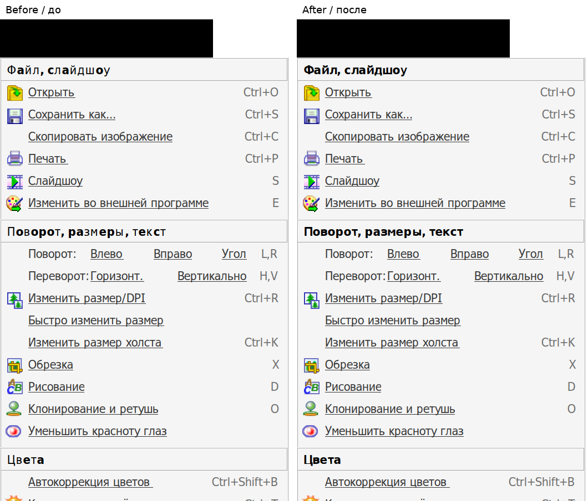
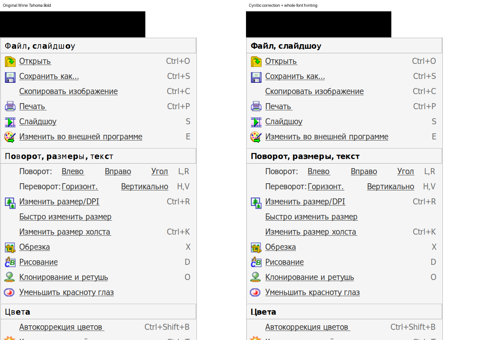
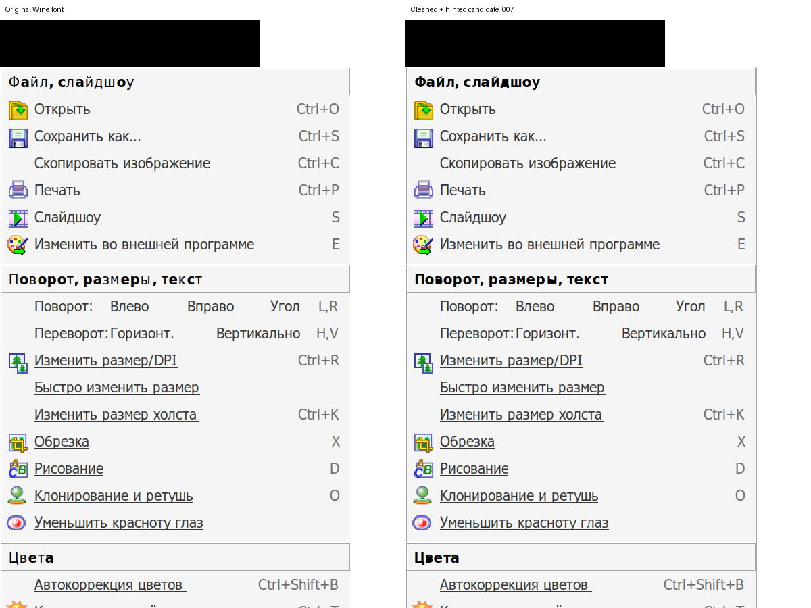

# Experimental Wine Tahoma Bold correction

Checkpoint: 2026-11-07. **Not an installable recipe or an accepted fix.**
The owner rejected the first outline-only candidate: mixed bold/regular weight
improved, but letter positioning still looked uneven. The hinted candidate
has been rendered in actual Wine and FastStone; owner acceptance is pending.
No candidate is left installed. Original prefix fonts/settings are restored.

This archive preserves the work and failures so the next session can continue
without reconstructing it from chat. Font-derived files remain under
LGPL-2.1-or-later; see COPYING.LIB and their embedded copyright/license records.
Original: Copyright (c) 2004 Larry Snyder, based on Bitstream Vera Sans,
Copyright (c) 2003 Bitstream, Inc. Agent-assisted modifications, 2026.

## Inputs and reproduction

Use pristine Wine 11.0 source at
`db11d0fe6a169c457e23d007e20404643d067aa8` from
https://github.com/wine-mirror/wine. The input `fonts/tahomabd.ttf` SHA256 is
`508a2acc88cd6abdd399ae79c9965db43fba75a46bb115117b55d2be2272d889`.
Dependencies used: FontForge 20230101, fontTools 4.46, ttfautohint 1.8.4.
Commands below run from this directory; export WINE_SOURCE pointing to that checkout.

```sh
fontforge -lang py -script font-lab/build.py \
  "$WINE_SOURCE/fonts/tahomabd.sfd" "$WINE_SOURCE/fonts/tahomabd.ttf" \
  "$WINE_SOURCE/fonts/tahoma.ttf" font-lab/candidate
# Unpack, without installing, Ubuntu Noble packages named in runtime-packages.json:
# ttfautohint and libttfautohint1t64, both version 1.8.4-1.1build2, amd64.
mkdir -p font-hints/runtime
dpkg-deb -x ttfautohint_1.8.4-1.1build2_amd64.deb font-hints/runtime
dpkg-deb -x libttfautohint1t64_1.8.4-1.1build2_amd64.deb font-hints/runtime
python3 font-hints/build-hints.py
```

The archived candidate binaries are the measured inputs; the scripts reproduce
the method. Do not assume byte-identical rebuilds across tool versions.
`font-lab/candidate/tahomabd.sfd` preserves editable outline source. The outline
builder changes only the 66 affected Cyrillic outlines and side bearings;
original advance widths and unrelated glyph outlines remain unchanged.
It corrects contour direction before changeWeight, bounds the ink to the
original advance, and centers it. These are experimental geometry choices.

## What passed and what did not

- Original Wine regular/bold Tahoma have zero glyph programs, absent fpgm/prep,
  and cvt [68,1297]. The hypothesis that edited letters lost existing hints
  while other letters retained them was false.
- FontForge autoInstr without autoHint produces global tables but zero glyph
  programs. autoHint stalls on the enlarged U+0404 contour. FontForge API
  `glyph.instructions` was unavailable in this installed version.
- Correcting contour direction before changeWeight was necessary. The final
  outline-only candidate still introduces self-intersections: U+0404 changes
  from validation 32 (missing extrema) to 36 (also self-intersection), and from
  55 to 667 points. Do not promote this candidate without resolving geometry.
- ttfautohint generated programs for 861/979 glyphs, including 50/66 changed
  Cyrillic glyphs. All decomposed outlines and hmtx entries match its input.
  It changes hinting for the entire face, including Latin, and changes gasp.
  Sixteen affected glyphs have no programs; uniform hinting is not established.
- FreeType loads all 979 glyphs at 12/14/16/24/28/32 ppem with its autohinter
  disabled. This proves loading, not visual quality.
- Bounded cleanup of all affected contours **timed out after 120 seconds**
  during U+049A removeOverlap. No cleaned revision 0.004 was produced.
  cleanup-worker.py, progress, error report and sanitized FontForge log are
  retained. compare-clean.py was not run because its input was not produced.

## Actual Wine / FastStone checks

Wine 11.0, FastStone 8.5 x86, win64 prefix, 192 DPI, original grayscale font
smoothing. Only synthetic white images and panel text appear in comparisons.
The outline-only and whole-font-hinted candidates have revisions 0.002/0.003.
A greater head.fontRevision is required to beat Wine's installed same-family
face; a private font with the same revision was loaded but not selected.
A temporary file in prefix windows/Fonts also overrides the face, and removal
restores it. No system Wine file or persistent font registry change was made.

At a requested 36-pixel bold size, GDI reported:

| Letter | Original advance / ink pixels | Outline-only | Whole-font hinted |
| --- | --- | --- | --- |
| Ф | 32 / 317 | 32 / 508 | 32 / 507 |
| а | 25 / 319 | 25 / 319 | 24 / 317 |
| й | 23 / 216 | 24 / 370 | 23 / 382 |
| x | 22 / 261 | 22 / 261 | 22 / 260 |

Font-unit advances match; GDI pixel rounding can differ. The first comparison
was rejected by the owner; the second has not been accepted. Keep both as
experimental, never silently add them to the verified FastStone recipe.





The read-only GDI renderer used for the pixel/advance check is archived as
font-lab/render.c. Build it with x86_64-w64-mingw32-gcc -municode and -lgdi32.
It takes a candidate font path (or `-` for the existing face) and an output BMP
path, loads a private font only for its own process, reports actual selection,
and removes that private resource before exit. The raw BMP is local output.

## Cleaned candidate 0.007 (latest)

[freetype/README.md](freetype/README.md) records a different emboldening method,
fast overlap cleanup and whole-font hinting. It removes the new contour
self-intersections instead of hinting the previous malformed geometry. The
complete build script was run successfully on the laptop (FontForge and an
unpacked ttfautohint 1.8.4); an initial retry failed because ttfautohint was not
on PATH, before supplying its explicit executable/library paths. No package
installation was needed. The rebuilt font is not claimed byte-identical.

Actual FastStone comparison: original left, cleaned/hinted 0.007 right. The
font was temporarily selected in the prefix and removed afterwards, with
settings restored. Owner acceptance is still pending; it is outside the
verified catalog and is not installed permanently.


