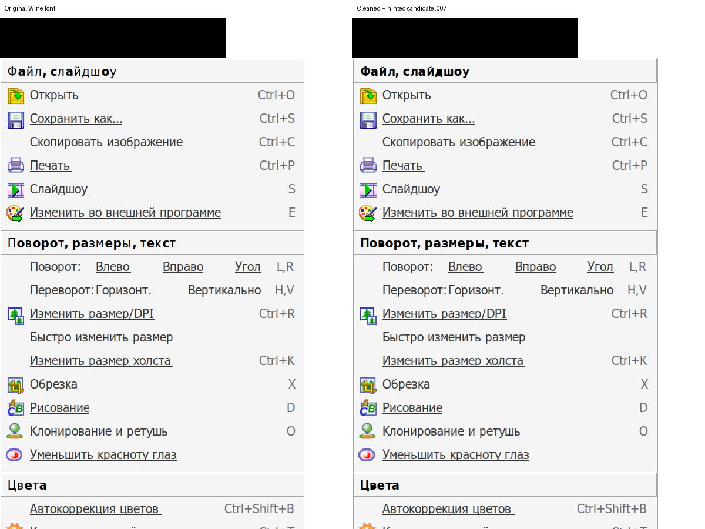

# Point-preserving emboldening and fast cleanup

Experimental continuation, 2026-11-07. **Not installed permanently; owner
visual acceptance is pending.** The earlier .002/.003 candidates are retained
only as failed/unfinished experiments.

Starting from pristine Wine 11.0 Tahoma Bold, FreeType FT_Outline_EmboldenXY
changes the same 66 glyphs without adding points. The builder preserves
original advances, fits original vertical control bounds, and updates the
left bearing to the new xMin. A higher head.fontRevision, not only a version
name string, is essential for Wine to select this face.

The first .005 result added 17 self-intersection flags. Unlike the previous
667-point FontForge-generated glyph, these short outlines can be cleaned in
under one second. correctDirection/removeOverlap/round on affected glyphs,
then merging those glyphs alone back into the source, gives .006. FontForge
reports 0 self-intersections and 0 wrong-winding flags across all 66 (original:
2 and 24). All advances and unrelated glyph outlines are preserved.

The original strict bbox check (0.01 font unit) flags two letters after cleanup;
max vertical curve-bound difference is **0.152220 font unit**, below 0.003 pixels
at a 36-pixel size for this 2048-unit face. This rounding difference is recorded
in validation-clean006.txt; do not call the bounds mathematically identical.
Missing-extrema flags still exist, as in the source.

Whole-font ttfautohint 1.8.4 then produces .007 with the same outlines/metrics
as .006 and a distinct PostScript name. Its hinting can change rasterized pixel
advances even though all font-unit advances match. Wine GDI private-font checks
confirm .006/.007 are actually selected. At 36 pixels, .007 gives Ф 32/453,
а 24/317, й 23/341, x 22/260 (advance/ink pixels). No claim of Windows glyph
shape equivalence follows from these counts.

Reproduce with Python fontTools/freetype bindings, FontForge and ttfautohint:

```sh
python3 build_clean.py /path/to/pristine/wine-11.0 /path/to/new-output
```

The original-source SHA/pin and LGPL notices are in the parent README. Tools
run only in the supplied output directory; they do not install a font or edit
Wine. The archived binary is the measured candidate, not a verified recipe.

The complete build was rerun successfully on 2026-11-07 using an explicit
`--ttfautohint` path and its unpacked shared library via LD_LIBRARY_PATH.
The initial invocation failed at the hinting step because ttfautohint was not
on PATH; cleanup had already completed. The build does not require installing
these tools system-wide. `validate_geometry.py` describes the point-preserving
raw .005 stage; cleanup deliberately changes point counts, and whole-font
hinting changes glyph programs, so that check is not a .007 acceptance test.


